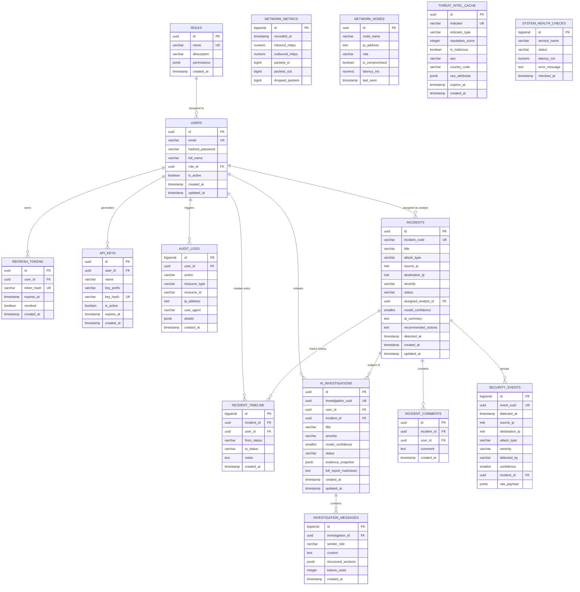

# AegisSOC — Database Architecture & Schema Specification

## 1. Overview

The AegisSOC persistence layer uses a hybrid data model:
1. **PostgreSQL 16+**: The primary relational database for ACID-compliant incident state tracking, role-based user management, audit trails, and structured investigation transcripts.
2. **PostgreSQL Range Partitioning / TimescaleDB**: For high-volume time-series telemetry (security events, raw flow records, and network throughput metrics).
3. **Redis 7+**: In-memory cache for sub-millisecond KPI retrieval, threat intelligence indicator caching (with 24-hour TTL), active WebSocket pub/sub message brokers, and session rate-limiting.

---

## 2. Entity-Relationship Diagram (ERD)



---

## 3. Relational Table Definitions (DDL)

### 3.1 Authentication & RBAC

#### `roles`
Stores authorization roles and permission sets.
```sql
CREATE TABLE roles (
    id UUID PRIMARY KEY DEFAULT gen_random_uuid(),
    name VARCHAR(50) UNIQUE NOT NULL,
    description VARCHAR(255),
    permissions JSONB NOT NULL DEFAULT '[]'::jsonb,
    created_at TIMESTAMPTZ NOT NULL DEFAULT NOW()
);

-- Seed default SOC roles
INSERT INTO roles (name, description, permissions) VALUES
('admin', 'Super Administrator with full system control', '["*"]'::jsonb),
('soc_lead', 'SOC Manager / Lead handling assignments and escalations', '["incidents:*", "investigations:*", "reports:*", "analytics:read"]'::jsonb),
('analyst', 'Tier 1/2 Security Analyst conducting triage and containment', '["incidents:read", "incidents:update_status", "investigations:*", "events:read", "analytics:read"]'::jsonb),
('auditor', 'Read-only compliance auditor', '["incidents:read", "events:read", "reports:read", "audit:read"]'::jsonb);
```

#### `users`
SOC analysts, managers, and operators.
```sql
CREATE TABLE users (
    id UUID PRIMARY KEY DEFAULT gen_random_uuid(),
    email VARCHAR(255) UNIQUE NOT NULL,
    hashed_password VARCHAR(255) NOT NULL,
    full_name VARCHAR(100) NOT NULL,
    role_id UUID NOT NULL REFERENCES roles(id) ON DELETE RESTRICT,
    is_active BOOLEAN NOT NULL DEFAULT TRUE,
    created_at TIMESTAMPTZ NOT NULL DEFAULT NOW(),
    updated_at TIMESTAMPTZ NOT NULL DEFAULT NOW()
);

CREATE INDEX idx_users_email ON users(email);
CREATE INDEX idx_users_role_id ON users(role_id);
```

#### `refresh_tokens`
Cryptographically secure rotation tokens for session management.
```sql
CREATE TABLE refresh_tokens (
    id UUID PRIMARY KEY DEFAULT gen_random_uuid(),
    user_id UUID NOT NULL REFERENCES users(id) ON DELETE CASCADE,
    token_hash VARCHAR(255) UNIQUE NOT NULL,
    expires_at TIMESTAMPTZ NOT NULL,
    revoked BOOLEAN NOT NULL DEFAULT FALSE,
    created_at TIMESTAMPTZ NOT NULL DEFAULT NOW()
);

CREATE INDEX idx_refresh_tokens_user_id ON refresh_tokens(user_id);
CREATE INDEX idx_refresh_tokens_hash ON refresh_tokens(token_hash);
```

#### `api_keys`
Machine-to-machine authentication for telemetry forwarders, syslog relays, and network agents.
```sql
CREATE TABLE api_keys (
    id UUID PRIMARY KEY DEFAULT gen_random_uuid(),
    user_id UUID NOT NULL REFERENCES users(id) ON DELETE CASCADE,
    name VARCHAR(100) NOT NULL,
    key_prefix VARCHAR(10) NOT NULL,
    key_hash VARCHAR(255) UNIQUE NOT NULL,
    is_active BOOLEAN NOT NULL DEFAULT TRUE,
    expires_at TIMESTAMPTZ,
    created_at TIMESTAMPTZ NOT NULL DEFAULT NOW()
);

CREATE INDEX idx_api_keys_hash ON api_keys(key_hash);
```

#### `audit_logs`
Immutable compliance and forensic audit ledger.
```sql
CREATE TABLE audit_logs (
    id BIGSERIAL PRIMARY KEY,
    user_id UUID REFERENCES users(id) ON DELETE SET NULL,
    action VARCHAR(100) NOT NULL,
    resource_type VARCHAR(50) NOT NULL,
    resource_id VARCHAR(100),
    ip_address INET,
    user_agent VARCHAR(255),
    details JSONB DEFAULT '{}'::jsonb,
    created_at TIMESTAMPTZ NOT NULL DEFAULT NOW()
);

CREATE INDEX idx_audit_logs_user_id ON audit_logs(user_id);
CREATE INDEX idx_audit_logs_created_at ON audit_logs(created_at DESC);
CREATE INDEX idx_audit_logs_resource ON audit_logs(resource_type, resource_id);
```

---

### 3.2 Incidents & Case Management

#### `incidents`
Central case management entity mapping directly to the frontend's `INC` object structure.
```sql
CREATE TYPE incident_severity AS ENUM ('Critical', 'High', 'Medium', 'Low');
CREATE TYPE incident_status AS ENUM ('New', 'Investigating', 'Contained', 'Resolved');

CREATE TABLE incidents (
    id UUID PRIMARY KEY DEFAULT gen_random_uuid(),
    incident_code VARCHAR(32) UNIQUE NOT NULL, -- e.g., 'INC-2041'
    title VARCHAR(255) NOT NULL,
    attack_type VARCHAR(100) NOT NULL,         -- 'Brute Force', 'Port Scanning', 'DDoS', etc.
    source_ip INET NOT NULL,
    destination_ip INET NOT NULL,
    severity incident_severity NOT NULL DEFAULT 'Medium',
    status incident_status NOT NULL DEFAULT 'New',
    assigned_analyst_id UUID REFERENCES users(id) ON DELETE SET NULL,
    assigned_analyst_name VARCHAR(100),         -- Denormalized cache for fast UI rendering
    model_confidence SMALLINT NOT NULL CHECK (model_confidence BETWEEN 0 AND 100),
    ai_summary TEXT,
    recommended_actions TEXT,
    detected_at TIMESTAMPTZ NOT NULL DEFAULT NOW(),
    created_at TIMESTAMPTZ NOT NULL DEFAULT NOW(),
    updated_at TIMESTAMPTZ NOT NULL DEFAULT NOW()
);

-- Optimized indexes for frontend filters, search, and ordering
CREATE INDEX idx_incidents_status ON incidents(status);
CREATE INDEX idx_incidents_severity ON incidents(severity);
CREATE INDEX idx_incidents_detected_at ON incidents(detected_at DESC);
CREATE INDEX idx_incidents_source_ip ON incidents(source_ip);
CREATE INDEX idx_incidents_search ON incidents USING GIN (to_tsvector('english', incident_code || ' ' || title || ' ' || attack_type));
```

#### `incident_timeline`
Tracks workflow state transitions (e.g., `New` ➔ `Investigating`).
```sql
CREATE TABLE incident_timeline (
    id BIGSERIAL PRIMARY KEY,
    incident_id UUID NOT NULL REFERENCES incidents(id) ON DELETE CASCADE,
    user_id UUID REFERENCES users(id) ON DELETE SET NULL,
    from_status incident_status,
    to_status incident_status NOT NULL,
    notes TEXT,
    created_at TIMESTAMPTZ NOT NULL DEFAULT NOW()
);

CREATE INDEX idx_incident_timeline_inc_id ON incident_timeline(incident_id, created_at ASC);
```

#### `incident_comments`
Operator collaboration notes.
```sql
CREATE TABLE incident_comments (
    id UUID PRIMARY KEY DEFAULT gen_random_uuid(),
    incident_id UUID NOT NULL REFERENCES incidents(id) ON DELETE CASCADE,
    user_id UUID NOT NULL REFERENCES users(id) ON DELETE RESTRICT,
    comment TEXT NOT NULL,
    created_at TIMESTAMPTZ NOT NULL DEFAULT NOW()
);

CREATE INDEX idx_incident_comments_inc_id ON incident_comments(incident_id, created_at ASC);
```

---

### 3.3 Security Events & Telemetry

#### `security_events`
High-throughput live event stream mapping directly to frontend's `EV` object structure.
```sql
CREATE TABLE security_events (
    id BIGSERIAL,
    event_uuid UUID NOT NULL DEFAULT gen_random_uuid(),
    detected_at TIMESTAMPTZ NOT NULL DEFAULT NOW(),
    source_ip INET NOT NULL,
    destination_ip INET NOT NULL,
    attack_type VARCHAR(100) NOT NULL,
    severity incident_severity NOT NULL,
    detected_by VARCHAR(100) NOT NULL, -- 'ML anomaly model', 'Signature rule', 'Threat intel match', 'Behavioural baseline'
    confidence SMALLINT NOT NULL CHECK (confidence BETWEEN 0 AND 100),
    incident_id UUID REFERENCES incidents(id) ON DELETE SET NULL,
    raw_payload JSONB DEFAULT '{}'::jsonb,
    PRIMARY KEY (id, detected_at)
) PARTITION BY RANGE (detected_at);

-- Monthly range partitioning for efficient pruning and retention
CREATE TABLE security_events_y2026m11 PARTITION OF security_events
    FOR VALUES FROM ('2026-11-01 00:00:00+00') TO ('2026-12-01 00:00:00+00');
CREATE TABLE security_events_y2026m12 PARTITION OF security_events
    FOR VALUES FROM ('2026-12-01 00:00:00+00') TO ('2027-01-01 00:00:00+00');

CREATE INDEX idx_events_detected_at ON security_events(detected_at DESC);
CREATE INDEX idx_events_src_ip ON security_events(source_ip);
CREATE INDEX idx_events_severity ON security_events(severity);
```

#### `network_metrics`
Throughput samples driving the dashboard's bandwidth charts (`tIn`, `tOut`).
```sql
CREATE TABLE network_metrics (
    id BIGSERIAL,
    recorded_at TIMESTAMPTZ NOT NULL DEFAULT NOW(),
    inbound_mbps NUMERIC(8,2) NOT NULL,
    outbound_mbps NUMERIC(8,2) NOT NULL,
    packets_in BIGINT NOT NULL DEFAULT 0,
    packets_out BIGINT NOT NULL DEFAULT 0,
    dropped_packets BIGINT NOT NULL DEFAULT 0,
    PRIMARY KEY (id, recorded_at)
) PARTITION BY RANGE (recorded_at);

CREATE TABLE network_metrics_y2026m11 PARTITION OF network_metrics
    FOR VALUES FROM ('2026-11-01 00:00:00+00') TO ('2026-12-01 00:00:00+00');

CREATE INDEX idx_net_metrics_recorded ON network_metrics(recorded_at DESC);
```

#### `network_nodes`
Tracks the network perimeter map nodes rendered in `#net`.
```sql
CREATE TABLE network_nodes (
    id UUID PRIMARY KEY DEFAULT gen_random_uuid(),
    node_name VARCHAR(100) NOT NULL,
    ip_address INET NOT NULL,
    role VARCHAR(50) NOT NULL,         -- 'bastion', 'gateway', 'dmz-web', 'workstation', 'finance-db'
    is_compromised BOOLEAN NOT NULL DEFAULT FALSE,
    latency_ms NUMERIC(6,2) NOT NULL DEFAULT 5.0,
    last_seen TIMESTAMPTZ NOT NULL DEFAULT NOW()
);
```

---

### 3.4 AI Investigations & Analyst Conversations

#### `ai_investigations`
Investigation sessions initiated in the AI Security Analyst workspace.
```sql
CREATE TABLE ai_investigations (
    id UUID PRIMARY KEY DEFAULT gen_random_uuid(),
    investigation_uuid UUID UNIQUE NOT NULL DEFAULT gen_random_uuid(),
    user_id UUID REFERENCES users(id) ON DELETE SET NULL,
    incident_id UUID REFERENCES incidents(id) ON DELETE SET NULL,
    title VARCHAR(255) NOT NULL,
    severity incident_severity NOT NULL DEFAULT 'Medium',
    model_confidence SMALLINT NOT NULL DEFAULT 85,
    status VARCHAR(50) NOT NULL DEFAULT 'completed', -- 'streaming', 'completed', 'failed'
    evidence_snapshot JSONB DEFAULT '{}'::jsonb,     -- Snapshot of incident metadata at time of query
    full_report_markdown TEXT NOT NULL,
    created_at TIMESTAMPTZ NOT NULL DEFAULT NOW(),
    updated_at TIMESTAMPTZ NOT NULL DEFAULT NOW()
);

CREATE INDEX idx_investigations_user_id ON ai_investigations(user_id);
CREATE INDEX idx_investigations_created_at ON ai_investigations(created_at DESC);
```

#### `investigation_messages`
Multi-turn conversational dialog and structured investigation outputs.
```sql
CREATE TABLE investigation_messages (
    id BIGSERIAL PRIMARY KEY,
    investigation_id UUID NOT NULL REFERENCES ai_investigations(id) ON DELETE CASCADE,
    sender_role VARCHAR(20) NOT NULL, -- 'user', 'assistant'
    content TEXT NOT NULL,
    structured_sections JSONB,         -- Stores the 6 structured report sections
    tokens_used INTEGER DEFAULT 0,
    created_at TIMESTAMPTZ NOT NULL DEFAULT NOW()
);

CREATE INDEX idx_investigation_msgs_inv_id ON investigation_messages(investigation_id, created_at ASC);
```

---

### 3.5 Threat Intelligence & System Diagnostics

#### `threat_intel_cache`
Aggregated indicators of compromise to minimize external API costs and latency.
```sql
CREATE TABLE threat_intel_cache (
    id UUID PRIMARY KEY DEFAULT gen_random_uuid(),
    indicator VARCHAR(255) UNIQUE NOT NULL, -- IPv4, IPv6, Domain, File Hash
    indicator_type VARCHAR(20) NOT NULL,    -- 'ip', 'domain', 'hash'
    reputation_score INTEGER NOT NULL,      -- 0 (clean) to 100 (malicious)
    is_malicious BOOLEAN NOT NULL DEFAULT FALSE,
    asn VARCHAR(100),
    country_code VARCHAR(2),
    raw_attributes JSONB DEFAULT '{}'::jsonb,
    expires_at TIMESTAMPTZ NOT NULL,
    created_at TIMESTAMPTZ NOT NULL DEFAULT NOW()
);

CREATE INDEX idx_threat_intel_indicator ON threat_intel_cache(indicator);
CREATE INDEX idx_threat_intel_expires ON threat_intel_cache(expires_at);
```

#### `system_health_checks`
Latency records for the 5 dashboard subsystems shown in `ovView`.
```sql
CREATE TABLE system_health_checks (
    id BIGSERIAL PRIMARY KEY,
    service_name VARCHAR(100) NOT NULL, -- 'Network monitoring', 'ML detection engine', 'AI investigation engine', 'Threat intelligence', 'Database connection'
    status VARCHAR(30) NOT NULL,        -- 'Healthy', 'Degraded', 'Down'
    latency_ms NUMERIC(7,2) NOT NULL,
    error_message TEXT,
    checked_at TIMESTAMPTZ NOT NULL DEFAULT NOW()
);

CREATE INDEX idx_health_service_checked ON system_health_checks(service_name, checked_at DESC);
```

---

## 4. Redis Key Structure & Caching Strategy

Redis is leveraged for high-speed volatile data structures:

| Key Pattern | Data Structure | TTL | Purpose |
| :--- | :--- | :--- | :--- |
| `kpi:summary:{range}` | String (JSON) | 10 seconds | Pre-computed KPIs for 24h, 7d, 30d timeframes |
| `traffic:latest` | List (FIFO) | None (capped at 40) | Rolling sliding window of `tIn` and `tOut` Mbps |
| `events:recent` | List (FIFO) | None (capped at 50) | In-memory cache of the latest security events |
| `ti:ip:{ip_address}` | Hash | 24 Hours | Threat intelligence reputation cache |
| `ratelimit:{user_or_ip}:{endpoint}` | Integer | 60 seconds | Sliding-window token bucket rate limiter |
| `session:{token_hash}` | Hash | 15 Minutes | Active JWT revocation / session status |
| `pubsub:events` | Pub/Sub Channel | N/A | Broadcast channel for incoming security events |
| `pubsub:traffic` | Pub/Sub Channel | N/A | Broadcast channel for 1.5s network traffic ticks |
| `pubsub:health` | Pub/Sub Channel | N/A | Broadcast channel for subsystem health updates |

---

## 5. Data Retention & Archival Policies

1. **Security Events (`security_events`)**:
   - Stored in hot storage (PostgreSQL partitions) for 90 days.
   - Partitions older than 90 days are detached, exported to Parquet format in object storage (S3 / MinIO), and dropped from PostgreSQL.
2. **Network Metrics (`network_metrics`)**:
   - 1-second raw samples retained for 7 days.
   - 1-minute downsampled aggregates retained for 30 days.
   - 1-hour downsampled aggregates retained for 1 year.
3. **Audit Logs (`audit_logs`)**:
   - Immutable write-only records retained for 365 days to meet SOC 2 and ISO 27001 compliance standards.
